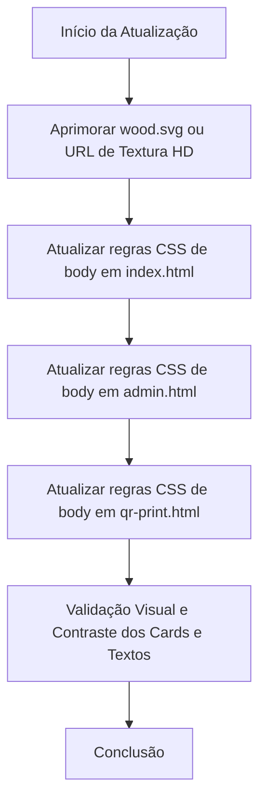

# Plano de Atualização do Fundo com Textura de Madeira de Alta Qualidade

## Visão Geral
Este plano detalha a atualização do fundo visual da aplicação (`Al Forno Pizzeria`), melhorando a textura de madeira (refinando [`wood.svg`](wood.svg:1) ou utilizando uma imagem de textura de madeira de alta qualidade com gradiente e sobreposição escura semitransparente) em [`index.html`](index.html:1), [`admin.html`](admin.html:1) e [`qr-print.html`](qr-print.html:1).

## Arquitetura da Solução


## Passos Detalhados

1. **Refinamento do Fundo SVG / Textura HD**:
   - Garantir que [`wood.svg`](wood.svg:1) possua detalhes rústicos de madeira de alta qualidade, veios marcantes e contraste ideal para o estilo bistrô rústico.
   - Opcionalmente combinar com uma URL de textura confiável ou manter/aprimorar o padrão SVG dinâmico escalável que não depende de conexões externas.

2. **Ajuste da Camada Semitransparente Escura (`background-image` / `linear-gradient`)**:
   - Atualizar a propriedade CSS `background` no `body` de [`index.html`](index.html:35), [`admin.html`](admin.html:32) e [`qr-print.html`](qr-print.html:29):
     ```css
     body {
       background-color: #12100e;
       background-image: linear-gradient(rgba(18, 16, 14, 0.88), rgba(18, 16, 14, 0.92)), url('wood.svg');
       background-size: cover;
       background-attachment: fixed;
       background-position: center;
       background-repeat: no-repeat;
     }
     ```

3. **Verificação de Contraste e Legibilidade**:
   - Garantir que os cartões (`.card`), painéis administrativos e textos mantenham excelente destaque e legibilidade sobre o novo fundo.
